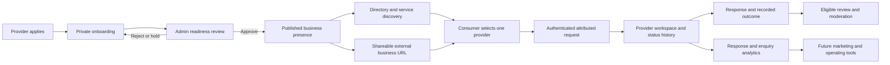

# Property Listify Services — Master Product Vision and Delivery Roadmap

**Document status:** Living strategic product authority, initialized from Edward's 2026-11-12 product directive. Product direction in the directive is adopted for planning. Specific commercial prices, offers, new data models, and changes to shipped contracts remain subject to their named decision authorities.

**Product owner:** Edward

**Delivery owner:** Property Listify product and engineering

**Current source baseline:** `origin/main` `93723fdb2a4ce928753d6a86e562c4e92a65c56d` (#761), refreshed 2026-11-13

**Next review trigger:** every Services release or approved product-direction change; refresh the full capability register at least at each roadmap phase boundary.

## 1. How this document governs Services

This is the umbrella reference for what Services is intended to become, how it connects to the existing platform, and how progress is measured. It is a living product authority, not an implementation specification for every feature.

It does **not** silently amend the more specific authorities:

| Authority                                                                                                                                                                                                   | Governs                                                                                                                                                                                                                        |
| ----------------------------------------------------------------------------------------------------------------------------------------------------------------------------------------------------------- | ------------------------------------------------------------------------------------------------------------------------------------------------------------------------------------------------------------------------------ |
| Repository `AGENTS.md`, security/privacy rules, database authority and applicable legal/commercial authorities                                                                                              | Engineering safety, access, data, claims and protected operations.                                                                                                                                                             |
| [Services V1 product contract](services-v1-product-contract.md)                                                                                                                                             | Shipped public behavior and its request, privacy, publication and custody boundaries. Reconciled against current source on 2026-11-12; later approved V2/V3 additions are called out without changing its authority.           |
| [Services V2 product contract](services-v2-product-contract.md)                                                                                                                                             | Approved MVP direction, trust rules and the approved free, controlled provider pilot while commercial research continues.                                                                                                      |
| [Services V3 growth contract](services-v3-product-contract.md)                                                                                                                                              | Approved provider growth journey and sequenced capability deltas; carries V2 commercial rules forward.                                                                                                                         |
| [Services engine state register](services-engine-state-register.md)                                                                                                                                         | Services delivery queue, status and asset reconciliation. It is operational tracking, not a product-decision authority.                                                                                                        |
| [Commercial Value Proposition and Acquisition Engine](commercial-value-proposition-acquisition-engine/00-aae-s0-final-strategic-audit-and-product-direction.md), its evidence authority and later decisions | Cross-platform commercial narrative, public offers, claims and route readiness. The existing AAE research leaves the service-provider commercial model unresolved; this Services authority must remain aligned with it.        |
| This master document                                                                                                                                                                                        | Strategic identity, outcomes, target users, capability map, roadmap and current evidence snapshot. A conflict with an approved V1/V2/V3 decision is surfaced for an explicit decision and reconciled in the specific contract. |

**Status vocabulary:** “implemented” means the capability exists in the reviewed source; it does not prove it is enabled or working in production. The register therefore records implementation, verification evidence, and commercial availability separately. The initial source audit was based on #761; feature-branch verification is recorded in §§14–15. The live deployment SHA and production database readiness remain unverified.

The session artifacts `services-launch-readiness-plan-2026-11-12.md` and
`services-current-state-commercial-audit-2026-11-12.md` were read as starting
evidence. Their material source claims were rechecked against #761. They are
unmerged session artifacts, not repository authorities, and this master does
not depend on them being present in `main`.

## 2. Product identity and vision

### Product definition

**Property Listify Services is a digital business-growth platform for property-related service companies.** It connects a consumer discovery marketplace with a provider's hosted business presence, enquiry conversion, operating workspace, and progressively richer growth tools.

The marketplace is one acquisition channel. A provider should gain a professional, shareable digital destination and an accountable way to receive and work opportunities, even when the customer arrives from the provider's own social media, WhatsApp Business, email, or advertising.

### Mission

Help property-related service companies establish their digital presence, become discoverable to relevant customers, convert interest into attributable enquiries, and progressively operate and grow their customer-acquisition business through Property Listify.

### Long-term vision

Become useful business infrastructure for property-related service companies: the place where a company presents its work, reaches property customers, handles enquiries, understands its performance, and adopts additional marketing and operating tools as those tools prove valuable.

### Strategic objectives

1. Make relevant providers easier for consumers to find and assess.
2. Give every approved provider a polished hosted business destination that can be shared outside the marketplace.
3. Turn customer interest into a private, attributable, one-provider opportunity with clear follow-up custody.
4. Give providers progressively useful tools to operate, market and improve their business.
5. Build recurring revenue from proven provider value, without charging for visibility or leads before the offer, demand and protections are approved.
6. Use evidence from providers and consumers to choose product investment and launch geography.

### Positioning

**Proposed provider proposition:** “Your business deserves more than a listing. Establish your digital presence, attract customers and grow with Property Listify.”

This is a positioning direction, not blanket authorization for public claims that Services currently provides automated customer growth, guaranteed demand, a complete website builder, CRM, or marketing automation. Public copy must describe capabilities that exist and are enabled for the audience seeing that copy.

### Differentiation from an ordinary directory

An ordinary directory treats a business as a row of searchable contact details. Services should connect four durable assets:

- a provider-controlled, structured business presence;
- discoverable services and truthful coverage;
- an attributable request and provider operating history;
- measured performance and optional growth tools built on evidence.

Property Listify can also bring property context to a service enquiry when the customer begins on a property journey. Context improves an enquiry only when it is relevant, validated and shared under the existing privacy boundary.

### Relationship to the Property Listify ecosystem

Services shares identity, authentication, canonical Place, support and trust authorities with the platform. It may receive context from buyer, seller, landlord, agent, agency, developer or owner journeys where the specific integration is approved. Services keeps one provider identity and one `service_leads` request authority; it does not become a parallel CRM or a copy of the listing/development engines.

## 3. Target customers and provider segments

### Consumer audiences

Property owners, buyers, sellers, landlords, tenants, agents, agencies, developers, property managers and businesses looking for property-related professional services. Their common job is to identify a suitable service, understand what the provider offers and where it works, then make a clear request without being misled about acceptance, timing or completion.

### Provider segments

The segment descriptions below are product hypotheses. Current platform data does not establish willingness to pay, job volume, category economics or provider retention. Test those with real providers before creating prices or tiers.

| Segment and examples                                                                                                                          | Likely needs                                                                                                                  | Product value to prove                                                                               | Workspace direction                                                                                           | Commercial hypothesis, not decision                                                                          |
| --------------------------------------------------------------------------------------------------------------------------------------------- | ----------------------------------------------------------------------------------------------------------------------------- | ---------------------------------------------------------------------------------------------------- | ------------------------------------------------------------------------------------------------------------- | ------------------------------------------------------------------------------------------------------------ |
| **Independent operator / microbusiness:** plumber, electrician, painter, cleaner, gardener, handyman, waterproofer                            | Affordable professional presence, service and area clarity, phone-first usage, low-friction enquiry, trust without a web team | A shareable business page that works as a digital home and a simple way to capture relevant requests | Profile/service editing, coverage, mobile inbox, clear next actions, basic follow-up                          | High price sensitivity; prove customer value before asking for a recurring fee.                              |
| **Specialist professional practice:** architect, inspector, conveyancer, insurance or finance specialist, property photographer               | Expertise, service scope, credentials where verifiable, project examples, qualified intake, evidence-led reputation           | Detailed service pages and trusted presentation that help a customer choose the right specialist     | Structured service information, relevant property context, review/report tools and an orderly request history | Value may be higher per engagement, but compliance, qualification and evidence requirements are also higher. |
| **Project-based contractor:** builder, renovation firm, solar/energy installer, security installer, landscaping or waterproofing company      | Scope qualification, operating area, portfolio, service/pricing context, project enquiries and follow-up                      | Portfolio-grade presence and enquiries with enough context to assess fit                             | Service-specific leads, notes/statuses, team workflow and campaign measurement later                          | Potential willingness to pay for demand or portfolio tools; validate lead quality and project economics.     |
| **Established multi-service or multi-team company:** moving company, property maintenance, cleaning, security, building or home-services firm | Multiple services/areas, staff ownership, routing, response control, reporting and integrations                               | One controlled business identity with scalable service discovery and opportunity workflow            | Multi-user roles, team inbox, routing rules, exports and analytics after evidence                             | Higher potential account value, but requires product depth, role/security design and support.                |

Current public taxonomy has six broad categories: Home Improvement, Finance & Legal, Moving Services, Inspection & Compliance, Insurance, and Media & Marketing. Plumbing, electrical, builders, cleaning, solar, security, architecture and landscaping are examples that need to map honestly into current categories and service codes. Do not expand a public taxonomy enum or introduce new geography merely to mirror this segment list; first prove consumer/provider search behavior and route the change through the relevant authority.

### Provider size and operating context

- **Independent operators** need a fast setup, excellent mobile presentation and minimal administration. Avoid presenting them with a complex CRM or paid plan before proving value.
- **Small businesses** need several service lines, accurate service coverage, a credible portfolio and a dependable shared enquiry routine.
- **Established companies** may need multiple users, locations, routing and reporting. These are separate needs, not a reason to overbuild the first profile model.

## 4. Product pillars and connected architecture

### Four pillars

| Pillar        | Customer outcome                                                       | Product role                                                                                                                |
| ------------- | ---------------------------------------------------------------------- | --------------------------------------------------------------------------------------------------------------------------- |
| **Discover**  | Find and compare relevant providers for a service and place.           | Category and location discovery, profiles, service pages, property context, search-engine entry and evidence-backed trust.  |
| **Establish** | Present the company as a professional, shareable business destination. | Provider business home, identity, services, pricing information, coverage, media, proof, and public URLs.                   |
| **Convert**   | Turn customer interest into an accountable opportunity.                | One-to-one enquiry, source/property context, request confirmation, provider response, status history and qualifying review. |
| **Grow**      | Improve reach and operate a healthier acquisition process.             | Performance measurement, campaigns, notifications, content and media tools, integrations, and later assisted intelligence.  |

### Product flow

### Current sources of truth

| Product concept                                | Current authority                                                                         | Boundary                                                                                                                                                                                            |
| ---------------------------------------------- | ----------------------------------------------------------------------------------------- | --------------------------------------------------------------------------------------------------------------------------------------------------------------------------------------------------- |
| User identity and role                         | `users` and existing auth/role authority                                                  | DELTA-12 is enabling public `service_provider` registration through the existing verification/legal flow; the account can manage only its own private onboarding until review approves publication. |
| Canonical business identity                    | `partners` one-to-one with a provider user                                                | Do not create a second Service identity or multi-branch organization without an evidence-backed, separately reviewed design.                                                                        |
| Business profile and publication               | `service_provider_profiles`, partner verification and the reviewed publication transition | Provider onboarding cannot verify or publish itself. Public eligibility is rechecked by reads.                                                                                                      |
| Service catalogue and provider-supplied prices | `service_provider_services`                                                               | ZAR min/max values describe the provider's own service price, not a Property Listify fee.                                                                                                           |
| Coverage and request geography                 | `service_provider_locations.canonical_place_id` and canonical Place Authority             | Do not use display text as geographic authority or widen a requested area.                                                                                                                          |
| Customer opportunities                         | `service_leads` and `service_lead_events`                                                 | Single request/CRM authority, idempotent request identity, one selected provider and privacy-scoped contact access.                                                                                 |
| Reviews and reports                            | `service_provider_reviews`, report records and recomputed aggregates                      | Reviewer eligibility, publication moderation and reporting remain guarded.                                                                                                                          |
| Provider subscription scaffolding              | `service_provider_subscriptions` tier/status vocabulary                                   | Retained for possible future entitlement; no provider fee or tier sale is approved.                                                                                                                 |

### Architecture principles

1. Extend the provider profile and service pages against existing authorities before proposing a new site-builder or CMS model.
2. Reuse the canonical Place resolver and a single `service_leads` authority.
3. Keep platform eligibility independent from payment until an explicit commercial design authorizes a change.
4. Preserve one provider identity and one public publication authority.
5. Separate product feature state from live release state. Source presence, test presence, deployment and operational adoption are separate evidence types.
6. Treat new schema as a product decision with a named Database Authority workstream; no schema is implied by this roadmap.

## 5. Provider business presence specification

### Product promise

Every approved provider should have a permanent Property Listify business destination it can share through WhatsApp Business, social media, email, its own advertising and offline materials. It should look like a professionally designed small-business website while remaining a structured Property Listify surface, not a promise of a custom domain or full visual website builder.

The conceptual URL in the product directive is `/services/providers/company-name`. The current canonical route family is `/services/provider/:slug` and `/services/provider/:slug/service/:service`. Keep the shipped canonical URL authority unless a later route migration has a documented SEO, redirect and compatibility plan; do not create a second provider identity or duplicate route merely to match a sketch.

### Proposed public information architecture

| Section                      | Purpose                                                                                                             | Current/future state                                                                                                                                                                                                      |
| ---------------------------- | ------------------------------------------------------------------------------------------------------------------- | ------------------------------------------------------------------------------------------------------------------------------------------------------------------------------------------------------------------------- |
| **Business home / overview** | Company identity, value proposition, introduction, trust facts, featured services and primary enquiry.              | Current provider profile is the foundation, with overview/services/areas/contact tabs. Improve hierarchy and completeness based on real onboarding.                                                                       |
| **About**                    | Business background, capabilities, operating context and verifiable credentials where appropriate.                  | Headline, biography and business details are supported. Do not imply verified credentials unless the platform has verified them.                                                                                          |
| **Services**                 | Clearly name each offering, show its price information where provided, describe fit and show listed coverage.       | Service catalogue and individual service routes exist. Provider description editing is implemented on this task branch through the existing service editor and field; database-backed runtime validation remains pending. |
| **Individual service page**  | A focused landing page for a specific provider service, with coverage, trust, price context and one enquiry action. | DELTA-1 is shipped; preserve canonical service slug, structured data and shared request authority.                                                                                                                        |
| **Areas served**             | Show only the Places in which the business says it operates.                                                        | Canonical Place-backed listed coverage exists; never present it as radius or travel-time coverage without a separate approved model.                                                                                      |
| **Portfolio / projects**     | Demonstrate past work with context, media, dates and consent.                                                       | Provider-supplied gallery URLs are supported. A managed media library and case/project records are future DELTA-5/6, evidence-gated.                                                                                      |
| **Reviews**                  | Show moderated, eligible feedback and computed aggregates.                                                          | V2 review system exists; no fake counts or unmoderated review claims. Report handling is manual.                                                                                                                          |
| **Enquiry**                  | Make the next step obvious and route a private request to the selected provider.                                    | One prominent request action is the current contact boundary. Do not expose private phone/email in the public payload or silently send to multiple providers.                                                             |

### Brand, content and interaction requirements

- Use one canonical company identity, supplied logo/gallery, profile headline and biography; provide a polished deterministic brand plate where an image is absent.
- Provide simple in-page navigation that works on mobile. Do not add navigation categories without useful content behind them.
- Make service name, description, category, price range (optional), service availability declaration, and listed coverage easy to read. Explain when no price was supplied rather than inventing one.
- Let providers keep business data current through authenticated self-service, subject to platform constraints. Role, verification, publication, subscription, reviews and computed performance remain platform-owned.
- Add an explicit copy/share action as a candidate MVP improvement after the current public pages and destinations are verified; direct canonical URLs must already be stable and sharable.
- Portfolio content must be provider-supplied with a future evidence/consent and moderation design; do not invent project outcomes, qualifications or before/after claims.
- Enquiry always says request/enquiry. It is not a booking, accepted quote, scheduled job or guarantee of service completion.

### SEO, URL and geography requirements

- Retain canonical self-referencing profile and per-service URLs, page-specific metadata and sitemap inclusion for eligible published content.
- Structured data must describe facts actually present in the page and meet the applicable search-engine specification at implementation time.
- No duplicate provider URL families, locale variants, or thin service-by-place pages. Each expansion needs canonicalization, redirects and noindex/indexing policy.
- A future service × Place landing page must match exact canonical provider coverage and the requested service. Do not widen geography using city labels or provider-entered free text.

### Business-presence maturity

| Level                                                      | Meaning                                                                                                                        | Acceptance                                                                                                                                              |
| ---------------------------------------------------------- | ------------------------------------------------------------------------------------------------------------------------------ | ------------------------------------------------------------------------------------------------------------------------------------------------------- |
| **Level 1 — Directory presence**                           | Search result with accurate identity, service, listed coverage and enquiry.                                                    | This is not enough to claim the long-term business-site proposition.                                                                                    |
| **Level 2 — Shareable business presence (MVP foundation)** | Polished mobile profile plus canonical per-service pages, editable business/service facts, trust and one clear enquiry action. | A provider can confidently share the page externally; profile and service pages are useful without a Property Listify consumer arriving through search. |
| **Level 3 — Business publishing tools**                    | Managed media/portfolio, richer content, simple custom brand settings, campaign links and meaningful engagement measurement.   | Add only after provider behavior establishes need and the data/consent model is reviewed.                                                               |
| **Level 4 — Growth operating platform**                    | Team workflows, campaign management, advanced analytics, communications and integrations.                                      | Separate capabilities with support, privacy, operational and commercial models.                                                                         |

Do not call Level 2 a full website builder. Do not make Levels 3–4 prerequisites for the first controlled launch.

### Experience and design standards

- Use the established Property Listify design system and a clean, professional visual hierarchy.
- Make provider profiles, service pages and onboarding work well on mobile before adding more navigation or dashboard panels.
- Present the provider as a real business destination, with clear identity, offering, coverage, evidence and one obvious enquiry action.
- Use concise, task-led workspace screens. Add a control only when it helps a provider complete a real task or understand a measured result.
- Keep descriptions, coverage, trust and pricing information accurate; explain missing information instead of filling it with generic claims.
- Keep navigation shallow and content useful. Do not create empty portfolio, campaign or analytics sections ahead of the capability that serves them.
- Preserve accessible labels, keyboard operation and reduced-motion behavior in public and authenticated experiences.

## 6. Provider workspace and operating tools

### Current workspace

- View and edit the provider profile, services and canonical Place coverage.
- View requests assigned to that provider; requester identity/contact details are visible only within the established authorization boundary.
- Filter and page requests, update status using the existing lifecycle, and record response notes/events.
- See request totals/source mix and measured response information where the event sample is sufficient.
- See onboarding/publication state and review readiness.

These capabilities existed in the #761 source baseline. In this task branch, the relevant focused suite passed (12 files, 160 tests); `pnpm test:authority` exited 1, with observed server setup/teardown failures including database initialization errors after the task-local database was unavailable. Verify the DB-backed journeys and exact deployed artifact before calling them production-ready.

### Workspace evolution

| Capability              | Future provider task                                                                  | Status and boundary                                                                                                                                                                                                     |
| ----------------------- | ------------------------------------------------------------------------------------- | ----------------------------------------------------------------------------------------------------------------------------------------------------------------------------------------------------------------------- |
| Business administration | Maintain profile, service facts, price ranges, media and coverage.                    | Profile/service/coverage editor exists; editable service descriptions are implemented on this task branch using the existing service field and mutation. DB-backed save/reload and release verification remain pending. |
| Enquiry operations      | Triage inbox, respond, update status, retain context and follow up.                   | Basic assigned inbox and status lifecycle exist. `quoted` is a status only; formal quotes are future work.                                                                                                              |
| Communication           | Know when a request arrives and what needs attention.                                 | Automated Services alert/reminder domain is not present; DELTA-8 must be designed fresh. Manual inbox monitoring is required for the pilot.                                                                             |
| Reputation              | Request, report, moderate and respond appropriately to reviews.                       | Review submission/moderation/reporting exists; manual triage, abuse prevention and provider rebuttal remain gaps/proposals.                                                                                             |
| Measurement             | Understand page interest, service interest, enquiry conversion, response and outcome. | Request source/status and response events are measured. Public profile/service impressions and end-to-end funnel reporting are not established as complete.                                                             |
| Marketing               | Create attributable campaign destinations and understand their performance.           | Campaign landing/capture capability is DELTA-2, not current.                                                                                                                                                            |
| Media and work proof    | Organize images/projects with ownership and moderation.                               | Gallery metadata exists; managed media and project model are DELTA-5/6, evidence-gated.                                                                                                                                 |
| External operations     | Export or hand over a lead to an existing system with appropriate consent.            | DELTA-9 future; Property Listify remains the attribution source of truth.                                                                                                                                               |
| Team scale              | Multiple users, roles, branches and lead assignment.                                  | Not MVP. Current one-provider identity must not be casually widened; evidence and a separate architecture review are required.                                                                                          |

## 7. Consumer experience and promise

### Customer journey

1. State the service need and select a category.
2. Select a canonical Place or valid location scope where supported.
3. Compare eligible providers using active service, listed coverage, submitted facts, platform verification, moderated reviews and named sorts.
4. Open a provider business presence or the relevant provider-specific service page.
5. Review the business, service details, pricing information if supplied, coverage and available trust evidence.
6. Send one authenticated request to the chosen provider, with relevant validated property/listing context where appropriate.
7. See an accurate confirmation identifying the recipient and current request state.
8. The provider responds and updates the request through its workspace. The customer may review only under the current qualifying-interaction and moderation rules.

### Customer promise and limits

Services helps customers discover a provider and send a request. It does not currently promise provider acceptance, quote delivery, schedule availability, appointment booking, payments, escrow, provider performance guarantees or completed service work. The UI and marketing must maintain the distinction between enquiry, quote, booking and completed transaction.

One request is routed to one selected provider under the existing V1 contract. No automatic mass matching, paid competition or multi-provider lead sale may be added by implication.

## 8. Trust, quality and marketplace integrity

1. **Identity:** one provider business identity tied to the authenticated provider; identity creation and application are separate from public publication.
2. **Applications:** providers may apply/register and prepare a private profile. Account creation does not admit a provider to the public marketplace.
3. **Publication:** only an authorized reviewer may publish, unpublish or reject through the existing readiness-checked, audited server action. Failed readiness stays private.
4. **Eligibility:** public results independently recheck active provider, verified partner state, active directory publication, eligible subscription state, active service and valid canonical coverage.
5. **Claims:** distinguish provider-submitted information from platform-verified information. Never claim professional licensure, insurance, qualifications, years in business, response speed or satisfaction without evidence and authority.
6. **Reviews:** enforce the approved request eligibility, one-review constraints, pending moderation, reporting and recomputed aggregate rules. Assign a human moderation owner during the pilot.
7. **Privacy:** provider contact and requester context are disclosed only under the existing V1 boundary and authenticated ownership. New share, campaign, export or notification behavior needs an explicit data/consent review.
8. **Requests:** preserve request key idempotency, selected provider/service/Place validation, allow-listed attribution context and server-validated property/listing/development references.
9. **Abuse and complaints:** define application screening, spam/duplicate handling, reports, support escalation, suspension and withdrawal processes before opening public applications.
10. **Geo integrity:** use canonical Place identity; do not merge or widen geography based on display text.

## 9. Commercial model and monetization strategy

### Approved today

V2 §3.1 approves a **free, controlled founding-provider pilot while the commercial model is validated**. Provider subscriptions, paid placement, lead fees, territory exclusivity and consumer/provider tier merchandising are not approved. V3 explicitly carries this posture forward. Retained subscription tier/status schema and trial defaults are technical scaffolding, not a paid offer.

The provider-supplied service price range is the price of the provider's work. It is not a platform fee. Services leads currently store `billingEligible = 0` and a null billing tier snapshot; no Services fee-collection, charge, entitlement or refund authority is implemented.

Agent Launch Access is a separate product and its price is not a Services benchmark. It sells access to a real-estate professional workflow, whereas a Services model may sell business presence, productivity, marketing or customer-acquisition value. Do not match its price without a separately approved bundle rationale.

### Commercial hypotheses to investigate

| Model                                  | Provider pays for / why                                                                                     | Value required                                                                                                       | Operating and technical requirements                                                                                                                                                                                                                | Risks and suitable timing                                                                                                                                                |
| -------------------------------------- | ----------------------------------------------------------------------------------------------------------- | -------------------------------------------------------------------------------------------------------------------- | --------------------------------------------------------------------------------------------------------------------------------------------------------------------------------------------------------------------------------------------------- | ------------------------------------------------------------------------------------------------------------------------------------------------------------------------ |
| **Business-presence subscription**     | A recurring fee for a maintained hosted business site and service pages.                                    | Providers use the URL as a durable digital destination and can update it; pages produce value beyond portal traffic. | Approved catalog/entitlement authority, clear billing term, self-serve management, cancellation, support, proof of product value and no unfair paid-publication dependency.                                                                         | Can monetize providers without relying entirely on lead volume; risks charging for commodity pages or excluding small operators. Research after MVP usage evidence.      |
| **Provider productivity subscription** | A fee for advanced inbox, team access, follow-up, analytics, exports or workflow tools.                     | Tools save time, improve response and are used regularly.                                                            | Team authorization, data retention, notifications, support/SLA, usage measurement, billing, downgrade/retention semantics.                                                                                                                          | Better recurring value if workflow becomes indispensable; do not monetize basic access before it works. Later phase.                                                     |
| **Qualified enquiry / lead product**   | A transparent charge for an eligible, attributable opportunity, possibly within provider-controlled budget. | Requests are relevant, deliverable and valuable enough to contact; attribution and quality are trusted.              | Define billable event, qualification, exclusivity, invalid/duplicate rules, credits/disputes, cap/pause controls, fraud detection, consent and accounting. Current one-provider routing is a foundation but there is no Services billing authority. | Providers may be charged without winning or completing work; disputes and bad leads can destroy trust. Only test after stable real demand and explicit founder approval. |
| **Campaign and promotional products**  | A fee for a specific campaign or labeled promotional placement.                                             | Reach is incremental and measurable; provider controls spend and geography/category.                                 | Campaign management, audited attribution, budget and schedule controls, ad labeling, ranking isolation, consent and SEO/noindex rules.                                                                                                              | Paid ranking undermines marketplace trust if opaque. Do not introduce until audience and campaign reporting exist and it is approved.                                    |
| **Hybrid presence plus acquisition**   | Subscription for business tools plus optional controlled acquisition spend.                                 | Presence/workspace has standalone value and providers can opt into measurable demand.                                | Entitlement and campaign/lead billing domains must stay explicit and separable; easy opt-out, spend cap and billing dispute mechanisms.                                                                                                             | Could diversify value and revenue, but combines operational complexity. Consider only after the component offers are validated separately.                               |
| **Completed-transaction commission**   | A fee on completed work or payments processed.                                                              | Platform materially coordinates booking, fulfilment and payment.                                                     | Booking, provider/customer contract, completion evidence, payment collection, refunds, disputes, tax, liability and support.                                                                                                                        | Not compatible with current enquiry-only product; long-term research only.                                                                                               |

### Recommended commercial sequence

1. Run the controlled founding cohort at no charge, with a clearly stated scope and a review date. A fixed pilot duration, lifetime-free promise, future price, or conversion obligation is **not** set by current decisions; Edward must approve the offer terms before provider recruitment copy states them.
2. Record supply, views, enquiries, request quality, provider response, outcomes, provider effort, support effort and retention. Do not count an enquiry as a job or revenue.
3. Interview providers across independent, small and established segments. Ask about actual use, alternatives, time saved, business value, acceptable price structures and objections; distinguish stated willingness-to-pay from observed payment.
4. Model per-segment economics and test non-binding package/price offers before taking money.
5. Bring DELTA-11 to Edward with evidence, options, operating cost, provider protections and recommendation. Only after approval design plans, billing and public offers.

Current competitor references are design patterns, not South African prices: Thumbtack's Pros page describes no membership/subscription fee and provider-controlled lead budgets ([Thumbtack for Pros](https://www.thumbtack.com/pro)); HomeAdvisor/Angi describe variable per-lead charges that may apply even when a provider does not win ([HomeAdvisor how it works](https://www.homeadvisor.com/spa/how-it-works), [provider terms](https://www.homeadvisor.com/rfs/terms/serviceProfessionalTerms.jsp)); Angi describes provider advertising, homeowner membership and separately booked services as different revenue lines ([Angi FAQ](https://www.angi.com/landing/faq)). These are largely US-facing products. Existing internal AAE market research identifies service providers as requiring a dedicated commercial-model decision and notes limited local portal precedent; it does not approve a Services fee.

## 10. Product analytics and success measurement

### Measurement status

Current source supports request counts/status mix/source mix and measured response events; public profile/service impression analytics, end-to-end funnel attribution, provider retention and provider satisfaction are not established as complete measurements. Existing event names must not be presented as a complete analytics product until their collection, coverage, consent and reporting are verified.

### Product scorecard

| Metric group                 | Measures                                                                                                                                                | Current status                                                                                                                                        |
| ---------------------------- | ------------------------------------------------------------------------------------------------------------------------------------------------------- | ----------------------------------------------------------------------------------------------------------------------------------------------------- |
| **Supply**                   | Approved active providers by category × canonical Place; eligible services; profile completeness; active supply and availability declaration.           | Can be derived from current directory/admin/provider records; aggregate operational dashboard/targets need definition.                                |
| **Discovery**                | Search volume, eligible result counts, empty-result rate, category/Place coverage, profile and service-page views, source/referrer.                     | Request/source instrumentation exists in part; page exposure and full funnel reporting need verification and may need a privacy-reviewed event slice. |
| **Conversion**               | Profile-to-request rate, service-page-to-request rate, request completion/drop-off, valid/duplicate/invalid request rate, request context completeness. | Request creation/idempotency exist; funnel denominators and request-quality taxonomy are not a complete product report.                               |
| **Provider operations**      | Time to first recorded response, response coverage, status distribution, quoted/won/lost/expired mix, overdue/unworked requests.                        | Median response measurement exists with a minimum sample gate; dashboards do not establish operational alerts or a service outcome.                   |
| **Consumer outcome**         | Contact success where consented, resolved/unresolved request, complaint/report rate, verified qualifying reviews.                                       | Request statuses/reviews/reports exist; service completion is not independently verified and should not be claimed.                                   |
| **Provider business health** | Profile engagement, enquiry value, provider activation, retention, satisfaction, support effort and referrals.                                          | Mostly future; collect qualitative evidence before creating vanity scores.                                                                            |
| **Acquisition economics**    | Provider acquisition cost, onboarding/review effort, consumer acquisition cost, cost per valid request, retained-provider cost-to-serve.                | Not measured as a Services commercial funnel. Instrument before a scale or paid decision.                                                             |
| **Commercial**               | Conversion to approved offer, revenue/provider, payment success/refunds, plan retention, contribution after support/acquisition.                        | No Services billing approved or implemented. These are future post-DELTA-11 metrics.                                                                  |

Any public metric needs a definition, date/window, minimum sample, source, denominator and responsible owner. Never fabricate a “qualified lead,” profile-view, response or conversion metric from partial request events.

## 11. Long-term opportunities

These are exploration areas, not automatic commitments:

- richer company site themes, content blocks and verified profile assets;
- provider-owned campaign landing pages and external traffic attribution;
- consented media/portfolio/project management;
- provider-controlled notifications and follow-up tasks;
- team seats, lead assignment and business operations;
- CRM export or integrations with Property Listify remaining attribution source;
- better provider business analytics and category/Place demand intelligence;
- AI-assisted business descriptions, service content and campaign drafts, with provider review and evidence-based claims;
- AI-assisted lead organization or response suggestions, without autonomously sending messages or making trust claims;
- property-context integrations that deepen relevant enquiries;
- carefully governed sponsored marketing, only after research and explicit approval.

## 12. Phased delivery roadmap

No calendar dates are invented. A phase advances when its exit evidence is met, not merely when the code exists.

| Phase                                      | Objective and audience                                                              | Capabilities and dependencies                                                                                                                                                                                                                        | Acceptance / exit                                                                                                                                                                                                                                                            | Commercial benefit and key risk                                                                                                                     | Founder decisions                                                                                                                      |
| ------------------------------------------ | ----------------------------------------------------------------------------------- | ---------------------------------------------------------------------------------------------------------------------------------------------------------------------------------------------------------------------------------------------------- | ---------------------------------------------------------------------------------------------------------------------------------------------------------------------------------------------------------------------------------------------------------------------------- | --------------------------------------------------------------------------------------------------------------------------------------------------- | -------------------------------------------------------------------------------------------------------------------------------------- |
| **0 — Product authority and foundation**   | One current product truth for founder, product, engineering and marketing.          | Adopt this master as umbrella strategy; reconcile V1/V2/V3 and status register; evidence inventory; agree next implementation workstream and launch decision owners.                                                                                 | Stale status references corrected; capability register has evidence and verification status; open decisions are explicit; no contract is silently superseded.                                                                                                                | Prevents duplicate work and unsupported claims. Risk: treating stale documents as requirements or turning every aspiration into MVP.                | Approve material policy choices only; strategy itself derives from directive.                                                          |
| **1 — Controlled MVP launch**              | Providers first for supply, then consumers in covered categories/Places.            | Public provider application; private onboarding; service-description editing; polished existing storefront; sufficient verified supply; one-provider enquiry; workspace and manual review/monitoring; support/release readiness. No booking/payment. | Provider can apply → register → complete private profile → submit for review → receive decision; only approved ready profiles publish. Consumer can discover, enquire, receive accurate confirmation; assigned provider can respond. Pilot coverage is truthful and staffed. | Establish acquisition and demand evidence. Risk: empty cells, missed requests without alerts, and overpromising a full website.                     | Initial categories/Places and single-provider exceptions; founding offer duration/terms; operational owners and response expectations. |
| **2 — Business presence expansion**        | Providers who need a stronger external business destination.                        | Editable service descriptions, share controls, richer structured business content, media/portfolio improvements, project proof and usability refinement. Build on current profile/service URLs.                                                      | A representative operator can keep a useful mobile business presence current and share it; page content improves decision quality; image rights/moderation defined.                                                                                                          | Creates a more defensible recurring-value candidate. Risk: premature CMS/schema or thin SEO pages.                                                  | Approve any new content classes or schema based on observed need.                                                                      |
| **3 — Customer acquisition and marketing** | Providers bringing their own audiences and investing in measurable customer growth. | DELTA-2 campaign capture, landing routes, marketing analytics, campaign controls and scoped category/Place promotion.                                                                                                                                | Campaign attribution joins existing idempotent leads; helpful non-thin landing experience; spend and indexability are explicit; exposure and requests measurable.                                                                                                            | Supports provider acquisition products. Risk: thin pages, opaque ranking, unreliable attribution.                                                   | Approve campaign commercial form, sponsored labeling and any indexability class.                                                       |
| **4 — Provider productivity**              | Providers managing repeated or team-owned opportunities.                            | DELTA-8 notifications/reminders (fresh domain), follow-up work, role/assignment models if evidenced, workspace reporting, DELTA-9 export/handover with consent/legal review. V3 retains alerts before export.                                        | Delivery/retry/failure/ownership behavior is monitored; users can pause/withdraw; export has explicit scope, consent, retention and audit.                                                                                                                                   | Increases retention and standalone workspace value. Risk: notifications reveal private data; CRM becomes competing source of truth.                 |
| **5 — Commercialisation**                  | Providers with proven use/value and clear acquisition economics.                    | Complete DELTA-11 research; choose presence, productivity, acquisition or hybrid offer; pricing catalog, entitlement/billing/refund/terms and support. Preserve organic ranking and fair access unless explicitly amended.                           | Founder approves proposition, target segment, prices/terms, eligibility, cost model, billing and protections; metered events reconcile; cancellation/dispute works; public claims align.                                                                                     | Converts validated value into revenue. Risk: monetize before demand, unfair fees, charging for low-quality leads or confusion with Agent Access.    |
| **6 — Intelligent business platform**      | Established providers seeking leverage and operational insight.                     | AI-assisted content/marketing, business insight, smarter enquiry organization, deeper platform integrations.                                                                                                                                         | Value, data provenance, human review, privacy, failure behavior and prohibited claims are defined and measured before launch.                                                                                                                                                | Potential high differentiation and retention. Risk: automation makes unsupported claims, exposes personal context or acts without provider control. | Each capability approved by evidence and risk, not by roadmap label.                                                                   |

## 13. MVP definition and launch acceptance

### Provider acquisition and onboarding

- Public provider application and registration are available through a clear, truthful route.
- Email/account authentication uses existing platform authority.
- Provider profile is private by default; new partner remains pending/unpublished.
- Provider can enter business identity, services, editable service descriptions, optional ZAR service price ranges and canonical Place coverage.
- Applicant understands review criteria, cohort limitation, status, rejection/hold path and support route.
- Application does not promise public approval, leads, free access beyond the approved founding offer, or future pricing.
- Abuse, duplicate application, admin review and decision messaging are operationally defined.

### Provider business presence

- Approved provider has a professional mobile profile and one canonical shareable URL.
- Profile and service detail pages show current business/service facts, truthful coverage, submitted price where available and only eligible trust evidence.
- Individual service pages reuse publication, identity, service and enquiry authorities.
- A provider can maintain service details without staff editing database records.
- No full website-builder, custom domain or project database is required for first launch.

### Consumer discovery and conversion

- Pilot-visible service/Place coverage has real approved provider inventory; empty cells are hidden or described honestly.
- Only eligible providers with matching active service and canonical coverage return.
- Consumer selects one provider; authentication, idempotency, server validation, context and privacy are verified.
- Confirmation reflects the persisted request and correct provider; no promise of quote, booking, payment or completed service.
- Request and profile pages work at mobile and desktop breakpoints.

### Provider workspace and operations

- Provider sees only assigned requests; status transitions and notes are auditable.
- Named provider admission, publication review, request-monitoring, report-triage and support owners exist.
- Until DELTA-8 is deployed, an operator has a tested manual monitoring cadence and escalation path.
- Operators can reject, hold, unpublish and route a complaint through existing controls.

### Platform release

- Exact web/API/worker candidate and production database target are identified through authorities.
- Database Authority readiness, schema congruency and required reference data are verified through the governed process; health/liveness alone is insufficient.
- Email/auth/support and consumer/provider journeys are checked against the exact candidate.
- Monitoring, incident response, withdrawal/unpublish, release owner, and rollback plan are recorded.
- No production database operation, provider promotion, publication or deployment is authorized by this document.

## 14. Product capability and evidence register

The repository baseline is `origin/main` #761; branch-only changes are identified explicitly below. “Test file exists” is not a passing result. “Implemented on this branch; runtime release validation pending” means source and focused tests pass here, but the full deployed artifact and real end-to-end acceptance path remain unverified.

| Capability                                               | Pillar               | Phase           | Current implementation status                                                                             | Evidence                                                                                                                                                                                                                                                                                                                                                                                                                                                                                                                                  | Dependencies / next acceptance                                                                                                                                                                              | Priority / decision authority                                               |
| -------------------------------------------------------- | -------------------- | --------------- | --------------------------------------------------------------------------------------------------------- | ----------------------------------------------------------------------------------------------------------------------------------------------------------------------------------------------------------------------------------------------------------------------------------------------------------------------------------------------------------------------------------------------------------------------------------------------------------------------------------------------------------------------------------------- | ----------------------------------------------------------------------------------------------------------------------------------------------------------------------------------------------------------- | --------------------------------------------------------------------------- |
| Services homepage and six categories                     | Discover             | MVP             | **Implemented, release validation pending**                                                               | `client/src/App.tsx`; `client/src/pages/services/ServicesHomePage.tsx`; `ServicesCategoryPage.tsx`; service catalogue.                                                                                                                                                                                                                                                                                                                                                                                                                    | Verify live inventory, exact category/Place matching and empty states.                                                                                                                                      | P0 consumer launch; V1 behavior.                                            |
| Canonical provider discovery and coverage                | Discover             | MVP             | **Implemented, release validation pending**                                                               | `servicesEngineService.directorySearch`; canonical Place resolver and `service_provider_locations.canonical_place_id`.                                                                                                                                                                                                                                                                                                                                                                                                                    | Verify target/readiness and cohort coverage; do not widen unmatched geography.                                                                                                                              | P0; Place Authority.                                                        |
| Public provider inventory                                | Discover             | MVP             | **Implemented; current live snapshot previously empty**                                                   | Directory query and public empty state in `ServicesHomePage.tsx`; prior live observation 2026-11-12.                                                                                                                                                                                                                                                                                                                                                                                                                                      | Recruit and review actual cohort; verify each advertised category/Place cell.                                                                                                                               | P0; operations/founder pilot scope.                                         |
| Provider public applications                             | Establish            | MVP             | **Implemented and task-local DB-backed verified; release email and deployed-artifact validation pending** | `AdvertiseServicesPage.tsx` routes to existing role registration; `authRoutes.ts` permits the existing `service_provider` role through legal acceptance and email verification; verified users route to `/service/profile?verified=true`. `integration.services-provider-acquisition.test.ts` exercises real registration and verification routes against the task-owned MySQL database. The test captures verification mail in memory; it does not send email. It uses a synthetic local legal fixture, not approved live legal content. | Validate actual delivery with the configured mail provider and verify the exact release candidate.                                                                                                          | P0; application path approved, publication remains reviewer-controlled.     |
| Private provider onboarding                              | Establish            | MVP             | **Implemented and task-local DB-backed verified; release validation pending**                             | Real verification produced an authenticated provider session; identity/profile/service/Place onboarding used existing authorities. The new provider remained absent from public discovery until the super-admin publication transition; unpublish removed it again. Existing onboarding integration tests also pass.                                                                                                                                                                                                                      | Verify against the exact release candidate and actual current legal/mail authorities.                                                                                                                       | P0; preserve V1.                                                            |
| Manual publication/rejection                             | Trust                | MVP             | **Implemented, release validation pending**                                                               | `servicesEngineRouter.reviewProviderPublication`, `ServicesReviewWorkspace.tsx`; audited, readiness-checked super-admin decision.                                                                                                                                                                                                                                                                                                                                                                                                         | Assign owner/cadence; verify publish/reject/unpublish and audit in isolated environment.                                                                                                                    | P0; preserve V1.                                                            |
| Company profile / hosted presence                        | Establish            | MVP foundation  | **Partially implements vision**                                                                           | `ServiceProviderProfilePage.tsx` has brand plate, bio, gallery, services, areas, contact tab and request CTA.                                                                                                                                                                                                                                                                                                                                                                                                                             | Refine content hierarchy; verify external share and mobile experience; do not describe as full CMS.                                                                                                         | P1; product direction approved.                                             |
| Individual provider service pages                        | Establish / Discover | MVP             | **Implemented in main (DELTA-1 #704); release validation pending**                                        | `ProviderServiceDetailPage.tsx`; canonical metadata, service JSON-LD and sitemap; merged commit `bce489970`.                                                                                                                                                                                                                                                                                                                                                                                                                              | Verify representative published service against request attribution and mobile.                                                                                                                             | P0 storefront; do not rebuild.                                              |
| Service descriptions in editor                           | Establish            | MVP             | **Implemented and task-local DB-backed verified; release validation pending**                             | Provider editor reuses `replaceProviderServices` and `service_provider_services.description`; authenticated provider identity scopes writes, foreign service IDs are rejected, content is trimmed and limited to 2,000 characters, and blank optional descriptions clear to null. The real-DB integration test verified reload persistence, public projection after reviewer publication, and continued privacy when unpublished. No schema or migration changed.                                                                         | Verify the editor against the exact release candidate. Preserve current V1 behavior: edits to an already published active service appear immediately after save; there is no description-edit review state. | P1; approved existing-data refinement.                                      |
| Provider service price ranges                            | Establish / Discover | MVP             | **Implemented**                                                                                           | Service records accept ZAR min/max; page can show price or “price on request.”                                                                                                                                                                                                                                                                                                                                                                                                                                                            | Verify display copy and no confusion with platform fee.                                                                                                                                                     | P1; V2.                                                                     |
| Provider areas served                                    | Discover / Establish | MVP             | **Implemented using canonical Place**                                                                     | `service_provider_locations` references Place IDs; onboarding resolves canonical Places.                                                                                                                                                                                                                                                                                                                                                                                                                                                  | Verify public labels and exact matching; annotate V1's stale display-text geography paragraph.                                                                                                              | P0; Place Authority.                                                        |
| Built-in sharing                                         | Establish            | MVP refinement  | **Not found** (canonical URLs are manually shareable)                                                     | Profile/service canonical paths exist; no explicit share/copy control found in frontend audit.                                                                                                                                                                                                                                                                                                                                                                                                                                            | Add share action only after confirming platform URL and expected mobile/browser behavior.                                                                                                                   | P1 candidate; existing data only.                                           |
| Managed gallery/portfolio/projects                       | Establish            | Future          | **Partial / deferred**                                                                                    | Provider logo/gallery URLs exist in metadata; DELTA-5 media library and DELTA-6 content model are evidence-gated.                                                                                                                                                                                                                                                                                                                                                                                                                         | Collect real provider publishing behavior and consent requirements before schema proposal.                                                                                                                  | P2; DB Authority if schema.                                                 |
| Consumer request creation                                | Convert              | MVP             | **Implemented, release validation pending**                                                               | `ServicesRequestPage.tsx`; `servicesEngineRouter` and `servicesEngineService.createLeadFromJourney`; integration tests exist.                                                                                                                                                                                                                                                                                                                                                                                                             | Verify exact release, auth, duplicate replay, selected provider/service, Place, confirmation.                                                                                                               | P0; preserve one lead authority.                                            |
| Request attribution/property context                     | Convert              | MVP             | **Implemented in source**                                                                                 | `service_leads`, allow-listed source context, validated property/listing/development references.                                                                                                                                                                                                                                                                                                                                                                                                                                          | Ensure each surfaced source remains authorized; preserve privacy.                                                                                                                                           | P0; V1/V3.                                                                  |
| Request statuses and provider workspace                  | Convert / Grow       | MVP             | **Implemented in main (DELTA-7 #702); release validation pending**                                        | `ProDashboardPage.tsx`; status filter, request mix/totals, response panel; merged commit `3a18d781f`.                                                                                                                                                                                                                                                                                                                                                                                                                                     | End-to-end provider/requester ownership verification; train providers on manual inbox checking.                                                                                                             | P0; do not rebuild.                                                         |
| Provider notifications/reminders                         | Convert / Grow       | Phase 4         | **Not implemented; approved direction DELTA-8**                                                           | No Services lead alert path found; retired phase-0 notification engine remains prohibited.                                                                                                                                                                                                                                                                                                                                                                                                                                                | Define fresh channel, opt-in/consent, retries, failure and owner before code.                                                                                                                               | P1 operational alternative is named manual process; DELTA-8 before DELTA-9. |
| Consumer review submission/moderation/reporting          | Trust / Grow         | MVP             | **Implemented under V2; release validation pending**                                                      | `ServiceProviderReviewsPage.tsx`, moderation workspace and V2 MVP-8; current V3/state statuses need refresh.                                                                                                                                                                                                                                                                                                                                                                                                                              | Staff report queue; test eligibility and aggregate; document abuse/rebuttal limits.                                                                                                                         | P1 operational readiness; V2.                                               |
| Trust and professional credentials                       | Trust                | MVP             | **Partial**                                                                                               | Partner platform-verified state and factual profile fields; no generic evidence proves all legal/professional qualifications.                                                                                                                                                                                                                                                                                                                                                                                                             | Use only evidence-specific badges; qualification verification requires a separate policy.                                                                                                                   | P0 claims; V1/V2.                                                           |
| Response measurement                                     | Grow / Trust         | MVP             | **Implemented in main (DELTA-3 #701); release validation pending**                                        | 90-day median from `service_lead_events`, minimum 3 measured leads; merged `b2dd9a18b`.                                                                                                                                                                                                                                                                                                                                                                                                                                                   | Verify source/test and runtime sample gating; do not introduce additional metrics without evidence.                                                                                                         | P1; do not rebuild.                                                         |
| Services SEO/sitemap                                     | Discover / Establish | MVP             | **Implemented in main (DELTA-4 #700); release validation pending**                                        | Sitemap child, JSON-LD and category canonicalization; merged `dd5e11114`.                                                                                                                                                                                                                                                                                                                                                                                                                                                                 | Validate eligible pages on deployed domain; avoid thin geo variants.                                                                                                                                        | P1; do not rebuild.                                                         |
| Provider profile/service impression analytics            | Grow                 | Phase 3         | **Not complete / evidence unclear**                                                                       | Source-event snippets are not a complete measured visit funnel; no verified full exposure dashboard found.                                                                                                                                                                                                                                                                                                                                                                                                                                | Instrument definitions, denominators, consent, retention and dashboard before claims.                                                                                                                       | P1 roadmap; analytics authority.                                            |
| Campaign landing pages and provider campaign attribution | Convert / Grow       | Phase 3         | **Planned and approved as DELTA-2; not found shipped**                                                    | V3 DELTA-2 contract specifies attribution and `noindex` by default.                                                                                                                                                                                                                                                                                                                                                                                                                                                                       | Build on excellent presence; reuse lead authority; prove demand and avoid doorway pages.                                                                                                                    | P2; contract before code.                                                   |
| CRM export/handover                                      | Grow                 | Phase 4         | **Proposed future DELTA-9, ordered after DELTA-8**                                                        | V3 §3.6 retains platform as attribution authority; handover has consent/retention implications.                                                                                                                                                                                                                                                                                                                                                                                                                                           | Define export fields, consent, destination, audit and retention; legal/privacy review.                                                                                                                      | P2; separate approval.                                                      |
| Paid Services subscription/lead/campaign model           | Grow                 | Phase 5         | **Proposed / not commercially approved**                                                                  | V2 §3.1, V3 §3.5 and AAE decision record; leads set `billingEligible=0`.                                                                                                                                                                                                                                                                                                                                                                                                                                                                  | Research value, costs and providers; founder chooses model; then design entitlement/billing.                                                                                                                | P0 to keep unpriced; DELTA-11.                                              |
| Booking, scheduling and consumer payments                | Convert              | Future research | **Not implemented and not MVP**                                                                           | No current service transaction authority.                                                                                                                                                                                                                                                                                                                                                                                                                                                                                                 | Separate product, legal, payment and operational design.                                                                                                                                                    | P3 unless strategy changes; not required for pilot.                         |
| AI-assisted provider business tools                      | Grow                 | Phase 6         | **Exploratory**                                                                                           | No approved Services AI capability in current product authority.                                                                                                                                                                                                                                                                                                                                                                                                                                                                          | Establish user value, privacy, provenance, human control and non-fabrication.                                                                                                                               | P3; separate founder decision.                                              |

### Definition of verification status

- **Source evidence:** route/component/service/schema or merged change exists.
- **Test evidence (2026-11-13):** focused Services/auth tests passed (13 files, 163 tests), and the new `integration.services-provider-acquisition.test.ts` passed against the task-owned disposable MySQL database. `pnpm check` passed. `pnpm run lint:check` exited 0 with zero errors and 12,809 warnings. The required full `pnpm test:authority` run completed but exited 1: 812 files passed, 4 failed, 12 skipped; 5,914 tests passed, 22 failed, 99 skipped. Its four failing files are non-Services tests; serialized reruns passed after supplying a test-only JWT secret. See §15.
- **Runtime evidence:** a frontend-only browser smoke verified the acquisition route and role selection. A real application/API and DB integration test exercised registration, verification-token acceptance, onboarding persistence, description editing and reviewer publication. Email transport was captured in memory, and a synthetic local legal fixture was used; neither external email delivery nor current approved legal-release behavior was verified. The exact production release and behavior remain unconfirmed.
- **Operational evidence:** no proof of staffed provider review, enquiry monitoring, review/report triage or category supply is inferred from code.

## 15. Current baseline, risks and next workstream

### Current product position

The refreshed `origin/main` baseline remains #761 (`93723fdb2`); it does not include these branch changes. Provider acquisition and service-description editing are now backed by a real-MySQL application integration test on this task branch. The test registers and verifies a provider through the real auth routes, persists onboarding and descriptions, checks authorization and privacy, and exercises reviewer publication/unpublication. Verification email is captured in memory and the test installs a synthetic local legal fixture, so external delivery and the currently approved legal release remain unverified. Focused tests pass (13 files, 163 tests), `pnpm check` passes, and `pnpm run lint:check` exits 0 with zero errors and 12,809 warnings.

The full authority suite completed with 812 files passed, 4 failed, and 12 skipped (5,914 tests passed, 22 failed, and 99 skipped). The test failures are outside Services: 19 occurred in `commercial-launch-access-s4.integration.test.ts` (one missing test-only `JWT_SECRET`, 18 stale legal-release reads) and three 5-second timeouts occurred in `hostedDatabaseReadinessMonitor.pipeline.test.ts`. The remaining failed files reported legal-fixture setup/teardown errors. A focused seven-file concurrent reproduction showed the same shared `legal_active_release` race in the S4 tests, `integration.agency-listing-publication-lifecycle.test.ts`, `integration.agency-principal-bootstrap.test.ts`, and `integration.launch-readiness-walkthrough.test.ts`: one stale-release conflict, two stale-release conflicts and a fixture-cleanup foreign-key error respectively. S4, the agency lifecycle, the agency bootstrap, launch-readiness walkthrough and readiness pipeline passed when rerun serially; the S4 run used an ephemeral test-only JWT secret. The prior 346/469/12 run was a different failure mode: an authority-owned stale PID/socket prevented the local task database from starting, causing database initialization/teardown errors across the suite. Repository-documented recovery cleared only stale runtime artifacts and restored the exact disposable worktree target; no database files were deleted.

The branch is not merged or deployed. Services remains short of a full business-growth platform: there is no automatic lead alert, complete exposure funnel, managed portfolio, campaign builder or CRM handover, and monetization is not approved. Current production provider inventory and deployed artifacts remain separate release checks.

### Published service-description moderation

The current V1 contract permits edits to an active service description to appear publicly immediately after save. Existing review authority controls initial provider publication, unpublishing and review moderation; it does not hold provider text edits in a pending state or maintain a separate edit history. This is a real content-quality risk if a provider adds misleading or abusive claims. For the MVP, preserve the shipped V1 behavior: a new edit-review workflow would add operational delay and a new state without evidence that it is needed, while the existing reviewer can unpublish a provider and the support/report process can handle complaints. Do not claim that description edits are moderated. Reconsider only with pilot evidence and an explicit product decision; evaluate audit history and targeted review before adding any schema or state.

### Priority classification

| Priority                               | Finding                                                                                                                                                                                                                                          | Action                                                                                                                                                                                                                        |
| -------------------------------------- | ------------------------------------------------------------------------------------------------------------------------------------------------------------------------------------------------------------------------------------------------ | ----------------------------------------------------------------------------------------------------------------------------------------------------------------------------------------------------------------------------- |
| **P0 — launch impossible/unsafe**      | The branch is not on `origin/main` or confirmed in the live release. Actual email delivery and current legal release remain unverified. The full authority suite remains red due to concurrent shared legal-fixture mutation in unrelated tests. | Review and release through the normal process; obtain current legal and email-provider evidence, and resolve the repository test fixture concurrency issue in its own bounded workstream before requiring a green full suite. |
| **P0**                                 | No launch cohort/supply has been verified for chosen categories and Places.                                                                                                                                                                      | Recruit and review real providers before consumer advertising in those cells. Product/operations dependency, not fixed by more UI.                                                                                            |
| **P0**                                 | Exact production web/API/worker source and DB readiness not verified.                                                                                                                                                                            | Use release and Database Authority procedures in a separate production release phase.                                                                                                                                         |
| **P1 — core value materially limited** | Provider service description edits are DB-backed and tested on this task branch, but public edits to already-published services are immediate by existing V1 contract.                                                                           | Preserve this MVP behavior and disclose that edits are not separately moderated; assess need for edit audit/review from pilot evidence.                                                                                       |
| **P1**                                 | Automated new-request notifications do not exist.                                                                                                                                                                                                | Name a manual monitoring owner/cadence for pilot. Design DELTA-8 if manual coverage cannot be guaranteed.                                                                                                                     |
| **P1**                                 | No explicit copy/share control or full profile-view funnel was found.                                                                                                                                                                            | Validate whether direct URL sharing and lightweight exposure metrics are MVP-critical; do not invent analytics.                                                                                                               |
| **P2**                                 | Customization, managed media/portfolio, campaigns, CRM handover and paid tiers.                                                                                                                                                                  | Keep sequenced to roadmap phases and evidence; do not delay first supply-and-enquiry pilot.                                                                                                                                   |

DELTA-12 and DELTA-13 have task-local DB-backed application evidence and focused tests. The next workstream is review and release readiness: address the unrelated shared legal-fixture concurrency failures, verify current legal/email authorities, complete a browser walkthrough using a locally captured verification message if the governed preview path is available, and complete normal release gates. No migration, provider promotion, production data operation or deployment is part of this branch.

## 16. Open founder decisions

Items marked “proposed” are not approved merely by appearing here.

| Decision                                                   | Current position                                                                                                                                                        | Recommendation / required next step                                                                                                      |
| ---------------------------------------------------------- | ----------------------------------------------------------------------------------------------------------------------------------------------------------------------- | ---------------------------------------------------------------------------------------------------------------------------------------- |
| Product identity and four pillars                          | Set by the 2026-11-12 directive.                                                                                                                                        | Preserve Discover / Establish / Convert / Grow in future work.                                                                           |
| Provider signup then review                                | Directive and current clarification support applications followed by approval.                                                                                          | Open application; publication remains manual and private by default.                                                                     |
| Free founding-provider offer duration and terms            | V2 approves a free controlled cohort; exact term/benefits/expiry are unspecified.                                                                                       | Set review date and terms before provider recruitment claims; do not imply “free forever.”                                               |
| Initial launch categories and Places                       | Not established by code.                                                                                                                                                | Choose based on recruitable, real provider supply and demand evidence.                                                                   |
| Supply threshold                                           | Earlier launch plan proposes at least two independent providers per advertised cell with a limited single-provider exception; this is not an approved universal policy. | Edward chooses/approves any threshold and exception rule.                                                                                |
| Provider response expectation and human operational owners | Code does not name live operators.                                                                                                                                      | Name admission, review, inbox, moderation, support and incident owners; define measurable pilot expectations.                            |
| Business-presence experience                               | User directive makes it central; current canonical routes exist.                                                                                                        | Improve current structured profile rather than build a full site builder. Approve larger content or branding scope after pilot evidence. |
| Commercial model/price                                     | V2/V3/AEE leave it open behind DELTA-11.                                                                                                                                | Research subscription, productivity, qualified-request and hybrid models; do not inherit Agent Launch Access price.                      |
| Paid ranking/territory exclusivity                         | Not approved.                                                                                                                                                           | Keep prohibited unless separate trust, commercial and legal review changes policy.                                                       |
| Reviews, rebuttals and abuse tools                         | Existing moderated review mechanism; some future controls remain open.                                                                                                  | Staff current process; research automation/rebuttal separately.                                                                          |
| Booking or payment                                         | Not part of Services V1 and not supported by current transaction engine.                                                                                                | Keep out of MVP; only reopen with a distinct product/operating case.                                                                     |

## 17. Advertising and acquisition readiness

### Provider acquisition

**Approved proposition direction:** establish a professional digital presence, showcase services and coverage, receive attributable requests, and progressively gain business tools. The founding-provider funnel should say that providers apply, create a private profile and are reviewed before publication. It must not promise guaranteed placement, traffic, leads, bookings, revenue or a future price.

Recommended early channels are founder-led direct outreach and provider referrals to recruit the initial cohort, followed by focused social/industry outreach only for categories with a real onboarding and review capacity. This is a proposal to test, not a proven channel mix.

### Consumer acquisition

Advertise only categories and canonical Places where eligible providers are present and ready to respond. Measure empty results and stop or narrow campaigns when supply falls below the approved bar. Do not buy demand into an empty national directory.

### Campaign readiness requirements

- Provider applications work and have a staffed review path.
- Public pages explain the product at the capability level actually delivered.
- Real inventory is verified for advertised category/Place cells.
- Consumer request and provider response have an owner and support path.
- Tracking has agreed definitions and privacy review.
- Any spend is capped/approved and performance is not represented as proven before measurement.

## 18. Change and evidence discipline

Every Services workstream should:

1. Read this document and the relevant V1/V2/V3 clause before changing a capability.
2. Identify existing authority and current capability-register row.
3. State objective, acceptance evidence, dependencies, privacy/security boundaries and database classification.
4. Update the relevant capability row and Services state register when a feature/status changes.
5. Record whether evidence is source, test, runtime or operational; never collapse them.
6. Update this document when an approved product decision changes its roadmap or promise.
7. Preserve historical decisions and record supersession; do not rewrite an old approval as if it never existed.
8. Keep a distinct approval and release path for commercial pricing, protected database actions and production deployments.

## 19. Source basis and limits

### Repository authorities reviewed

- `docs/architecture/services-v1-product-contract.md`
- `docs/architecture/services-v2-product-contract.md`
- `docs/architecture/services-v3-product-contract.md`
- `docs/architecture/services-engine-state-register.md`
- `docs/architecture/services-v3-growth-journey-gap-assessment-2026-10-28.md`
- `docs/architecture/launch-readiness-and-product-convergence/03-launch-register.md` (Paid MVP scope; explicitly excludes Services)
- `docs/architecture/commercial-value-proposition-acquisition-engine/00-aae-s0-final-strategic-audit-and-product-direction.md`
- `docs/architecture/commercial-value-proposition-acquisition-engine/01-aae-s0a-market-competitor-research.md`
- `docs/architecture/commercial-value-proposition-acquisition-engine/10-aae-s1a-capability-and-evidence-authority.md`
- `docs/architecture/commercial-value-proposition-acquisition-engine/11-aae-s1a-capability-evidence-register.md`
- Source listed throughout the capability register, including `client/src/App.tsx`, consumer/provider Services pages, `client/src/features/services/onboarding/**`, `client/src/pages/pro/ProProfilePage.tsx`, `client/src/pages/pro/ProDashboardPage.tsx`, `client/src/pages/admin/ServicesReviewWorkspace.tsx`, `server/_core/authRoutes.ts`, `server/servicesEngineRouter.ts`, `server/services/servicesEngineService.ts`, `drizzle/schema/servicesEngine.ts`, and relevant tests.
- `services-launch-readiness-plan-2026-11-12.md` and `services-current-state-commercial-audit-2026-11-12.md`, supplied as session artifacts. They remain unmerged; source findings were rechecked at #761.

### Constraints and unverified evidence

- Latest refreshed `origin/main` was #761. The prior Services audit baseline is current; no later source commits were fetched.
- In this implementation worktree, 12 focused test files (160 tests) passed; `pnpm check` passed; `pnpm run lint:check` completed with zero errors and 12,797 warnings. `pnpm test:authority` ran and exited 1 (346 files passed, 469 failed, 12 skipped; 2,349 tests passed and 3,685 skipped), with observed server setup/teardown errors including `Database not initialized` after the task-local MySQL service was unreachable.
- Dependencies were installed in the task worktree with the repository's frozen lockfile; no lockfile change was made. `pnpm db:authority:status` resolved the exact disposable worktree target, but its database service was unreachable. The repository-owned start command refused startup because an authority-owned PID file was stale. No recovery was attempted and no database was accessed, migrated, seeded or changed.
- Exact production Vercel/Railway artifact SHA and production Database Authority readiness remain unverified.
- Public `.co.za` pages were previously observed in this conversation; prior browser inspection saw zero published providers and held provider acquisition. This is a dated snapshot, not an ongoing inventory guarantee.
- Competitor examples are not a South African rate card or validation of willingness to pay.
