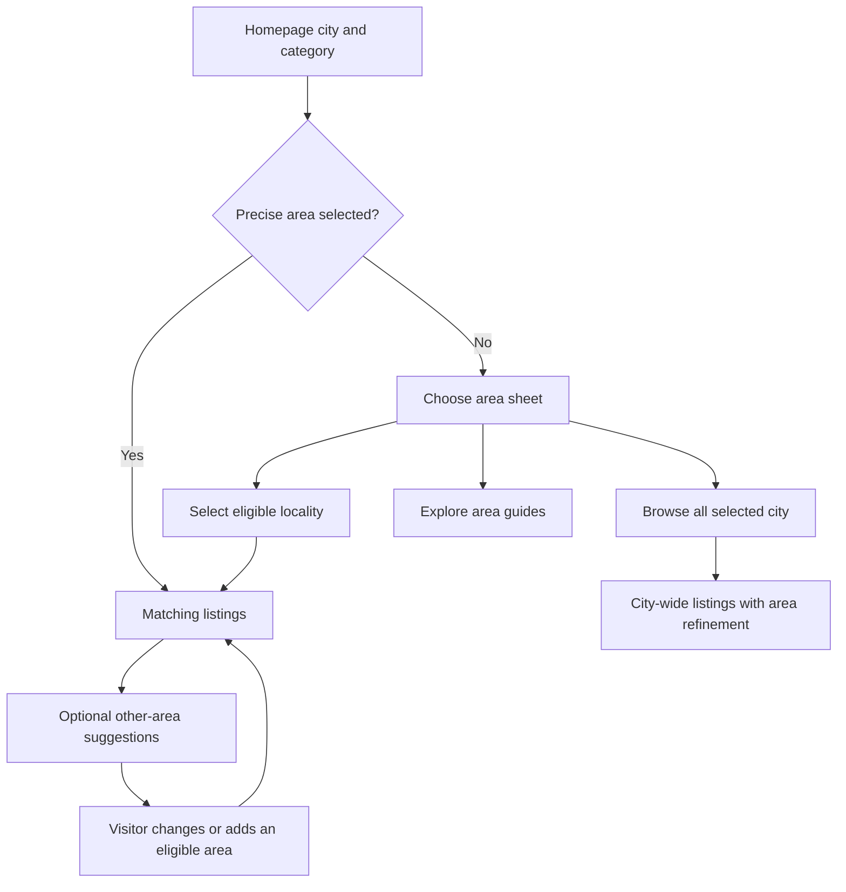

# Location search: product architecture recommendation

Date: 14 October 2026
Status: research record revised after founder direction; homepage implementation reviewed separately in `home-area-first-local-review-2026-10-14.md`
Workstream: `feat/homepage-ux-review-20261013`

## Decision

Support broad browsing and precise searching within one consistent journey. Make the geography visible and editable, offer narrowing before or alongside broad results, and expand only when the visitor deliberately changes the area.

Founder decision after reviewing this research: homepage Buy/Rent searches with broad geography clarify the area before navigating. A city-level search remains available through an explicit Browse all choice. Location-only entry continues to exploration. Do not guess a smaller area or make a guide page a mandatory transactional intermediary. Specific governed towns/localities can open directly even when their approved runtime handle is a city ID.

This recommendation addresses the second homepage section while preserving its visual category cards. It also defines the handoff the hero and results page must share. A section-only change cannot deliver continuity if those surfaces continue to hold unrelated location state.

## Evidence from other platforms

The following are verified product patterns, not controlled usability experiments or proof of conversion uplift. First-party help documentation describes behaviour; Property24's accessible current results page was also inspected. Help articles can lag individual devices or experiments. Private Property's inaccessible city results and its 2010 mapping article are not used as evidence of its current map behaviour.

| Platform          | Verified pattern                                                                                                                                      | Decision for Property Listify                                                                                                                     |
| ----------------- | ----------------------------------------------------------------------------------------------------------------------------------------------------- | ------------------------------------------------------------------------------------------------------------------------------------------------- |
| Property24        | The Cape Town sale page includes listings and links to specific areas, including Camps Bay, plus a directory of all areas.                            | Keep city browsing valid and expose locality refinement prominently.                                                                              |
| Rightmove         | Its documented flow starts with a location, then criteria, then results. Its draw tool can define and save a custom area.                             | Separate choosing geography from adding property criteria without losing either; defer custom drawing until supported.                            |
| Zillow            | Documents location search, school-boundary search and an applied custom drawing. Drawing requires removing the previous map boundary.                 | Make the active geographic boundary understandable; replacing scope is a deliberate operation.                                                    |
| Redfin            | Documents ambiguity selection, visible location boundaries, recent/saved searches, and explicit addition of up to five locations.                     | Show place context, remember explicit choices as suggestions, and make multiple-area membership visible.                                          |
| realestate.com.au | Documents surrounding listings appearing automatically after original matches; ordering uses listing upgrade tier and freshness rather than distance. | Offer alternatives separately. Do not inherit automatic expansion or imply paid order represents proximity.                                       |
| Airbnb            | Documents city/region and neighborhood/landmark searches, map exploration and autocomplete.                                                           | Allow both confident and exploratory entry. Defer landmark-distance and natural-language search until we can resolve and explain them accurately. |

Primary sources:

- [Property24 Cape Town sale results](https://www.property24.com/for-sale/cape-town/western-cape/432)
- [Rightmove search filters flow](https://faq.rightmove.co.uk/support/solutions/articles/7000100590-how-to-use-the-search-filters-to-find-properties-for-sale)
- [Rightmove Draw a Search](https://faq.rightmove.co.uk/support/solutions/articles/7000048757-draw-a-search)
- [Zillow property search](https://zillow.zendesk.com/hc/en-us/articles/227953268-How-do-I-search-for-properties)
- [Redfin search and ambiguity](https://support.redfin.com/hc/en-us/articles/360001432632-Searching-for-Homes)
- [Redfin multiple-area search](https://support.redfin.com/hc/en-us/articles/360025724771-Multiple-Area-Search)
- [REA surrounding-suburb behaviour](https://help.realestate.com.au/hc/en-us/articles/12802061194649-How-the-Surrounding-Suburbs-feature-works)
- [Airbnb search](https://www.airbnb.co.uk/help/article/252)

The recommendation is our inference from these patterns and the repository contracts. These platforms do not establish that forced suburb selection is superior; we should validate our choice with local users.

## Current repository findings

- `DiscoverProperties.tsx` defaults to Cape Town and Buy independently of `EnhancedHero.tsx`. The desktop/mobile home views provide no selected-location intent to this section.
- City tabs change local display state. Category cards and browse links use `publicDiscoveryRoutes.ts`, which builds city/province query strings from the city name and `CITY_PROVINCE_MAP`.
- Development cards use the city name as free-text `search`; that is not proof of a bounded geographic query. Their marketing category labels intentionally do not become invented backend filters.
- The hero keeps its own canonical location selections. With no journey and one location, it can open a neutral discovery page. Buy/Rent goes to transactional results with retained criteria.
- `CanonicalPlaceSelector.tsx` and the results search bar already support typed, eligible single Place selection, ambiguity, errors and empty lookup states. `searchIntent.ts` supports one `canonicalPlaceId` as the sole authority and rejects competing geography.
- The older hero adapter supports canonical location scope and compatible sibling multi-selection. Its UI limit is five, while the broader scope validation contract allows up to ten. This does not prove a multi-Place-ID contract exists: the single-Place results path explicitly rejects multiple Place IDs.
- Existing city pages have area exploration, but they are neutral discovery surfaces. Using them as a mandatory transactional intermediary would add a detour and needs filter preservation that cannot be assumed.
- The old `LocationSelectionModal.tsx` contains handwritten city/suburb arrays. It is not a geography authority and should not be reused as the source for this work.
- `NearbySuburbs.tsx` is a display component that links to location pages. Its existence does not establish a current, governed nearby query or a filter-preserving transactional destination.

No data/service query was changed or executed for this research. No database initialization, migration or seed operation was needed.

## Proposed customer experience

Retain the existing cards and add a compact area row below the city choices:

> Where would you like to look? · Choose an area

If the visitor has explicitly selected a precise locality, show that instead:

> Camps Bay · Change area

Do not prefill Cape Town. City tabs provide a browsing hint that must resolve through the governed lookup before it can power a query. A confirmed city-wide selection shows All areas; a precise selection shows the selected place.

| Visitor action/state                              | Response                                                                                                         |
| ------------------------------------------------- | ---------------------------------------------------------------------------------------------------------------- |
| Selects a city tab                                | Update browse context and reveal area refinement; no immediate navigation.                                       |
| Selects an exact locality and clicks a category   | Open matching listings directly; no extra confirmation.                                                          |
| Clicks a category with only a broad city context  | Open a compact area sheet with the category retained: choose an area, Browse all [city], or Explore area guides. |
| Explicitly chooses Browse all [city]              | Open city-wide results and label them as such; no repeat precision prompt.                                       |
| Uses the hero Search button with an explicit city | Clarify the area before navigation, with explicit Browse all as an alternative.                                  |
| Has no selected location                          | Ask for a city/locality, while keeping the chosen journey/category visible.                                      |
| Enters an ambiguous name                          | Present distinguishable, eligible candidates with their context; do not auto-pick the first.                     |
| Enters an unsupported/unresolved name             | Keep the query and explain the lack of a selectable match. Do not replace it with the city.                      |
| Gets zero exact matches                           | Keep the area and filters; offer changing filters, saving the search, or explicitly choosing another area.       |
| Has a lookup/results error                        | Offer retry; do not describe failure as no inventory.                                                            |

The category sheet should have one input and a small initial set of eligible suggestions, with keyboard support, dismissal, focus restoration and a reachable city-wide action. Short visible suggestions are not the full area catalogue. Always provide search. Do not label suggestions Popular or Best without data that supports the claim.

The result header explains the active scope and criteria, for example:

> Apartments for sale in Camps Bay · Up to R3 million
> Camps Bay only · Change area

City-wide results instead say:

> Apartments for sale across Cape Town
> All selected city areas · Choose a suburb or area

Examples are proposed copy, not a claim that these locations or budgets currently have inventory.

## Architecture boundaries

1. One shared journey composer holds the explicit transaction, supported property criteria and one resolved geography selection. Use existing search-intent parsing/generation and consumer journey adapters. Do not create another route or location authority in this section.
2. Share selected intent between hero and category section. Current explicit edits win over previous search suggestions. Carry exact criteria through results, property detail, Back and auth return. The URL represents submitted intent; input text alone is not submitted geography.
3. Reuse eligible Place discovery for new single-place selection where that consumer contract is active. Resolve city tiles through authoritative identities. Never derive a Place ID from a name/slug, and never append city/province text or a legacy location handle alongside a Place-ID query. Existing adapters remain bounded by their registered rollout; this UI is not permission for global consumer migration.
4. Request exactly the scope the visitor selected. City queries use the approved city membership projection, not an assumed entire municipal boundary. Administrative regions, factual localities and governed market Search Areas remain distinct. Do not invent Atlantic Seaboard, Johannesburg North or Sandton boundaries from marketing labels.
5. Nearby suggestions need separate eligibility and proximity evidence. Same-parent membership is not proof of proximity; display labels, postcode resemblance and provider suggestions are not search authority. If we lack a supported source, omit Nearby rather than guess. Exact results remain unchanged until the visitor chooses a candidate.
6. Preserve non-geographic filters when geography changes and reset pagination. State clearly when an incompatible multi-selection is replaced. Offer Add area only for journeys and compatible selection forms the current endpoint actually supports. Single Place IDs must not be converted into an unregistered multi-Place query.
7. Counts, when available, must match the active journey/category/filters and distinguish loading from zero. Do not reuse a city's total listings as a suburb/category count. Ranking and future paid placement operate within eligible matches; paying cannot expand geography or make an outside-area result look like an exact match.
8. Preserve domain contracts for Developments, Shared Living, Commercial and Land. Land retains one permitted geography authority and its public classification allow-list. Do not activate a disabled journey or substitute residential search for it.

## Personalization

Start with continuity, not inference: recent explicit searches, removable location chips and an optional Continue your last search action. Recent search is a suggestion, not a permanent preferred area. A like does not silently change location or budget. Current physical location is not necessarily where someone wants to buy; do not request GPS for this MVP.

Session continuity can avoid asking twice. Cross-device persistence belongs to an authenticated account and existing saved searches. Any persistent recent-search storage needs clear/remove behaviour and bounded retention. Do not advertise a personalized recommendation until there is an actual explanation and supporting signal.

## Delivery order

1. **First reviewable slice:** keep homepage styling; implement the area row and category sheet for supported Buy/Rent single-location searches, with Browse all city and precise-scope results handoff. Preserve existing account prompt work. No polygons, new geographic groupings or personalized ranking.
2. **Connected results slice:** prominent scope summary and Change area, filter-preserving navigation, explicit recent-search continuity and honest zero/error states. These are required before claiming a fully connected journey.
3. **Expansion slice:** compatible multi-area controls and separately labelled alternatives only after the exact supported contracts and suggestion source are verified. Maintain separate journey support checks.
4. **Later:** governed region discovery, map drawing, radius and commute constraints. These require boundary/proximity/transport contracts and validation; they are not cosmetic UI additions.

## Verification and learning plan

Walk through broad-city browsing, precise suburb lookup, ambiguous names such as Brooklyn, explicit city-wide opt-out, a city change after selecting a suburb, Back from detail, optional second-area selection, no inventory, failed requests, and account-return navigation. Validate mobile keyboard access, focus, overflow and loading announcements.

Automated checks should prove no mixed authority, no silent expansion, preserved journey/category/budget, pagination reset, stale autocomplete-response rejection and strict errors. Single-place and existing sibling multi-location contracts must each be tested without conflating them.

Conduct short task-based sessions with people who know their suburb, people relocating who know only the city, and people comparing several areas. Ask them to explain where the results are searching. Measure task completion, clarification abandonment, successful narrowing and whether users understand the boundary. Track direct category-to-property opens and broad-search refinement. These are proposed observations/events; no new telemetry or measured uplift is claimed.

## Review status

The research commit originally changed no runtime code. A subsequent homepage implementation follows the founder’s area-first decision and is recorded in `home-area-first-local-review-2026-10-14.md`. This record does not authorize a new geography authority, ranking change, price model or global results redesign. Push, merge and deployment remain outside the local workstream.
